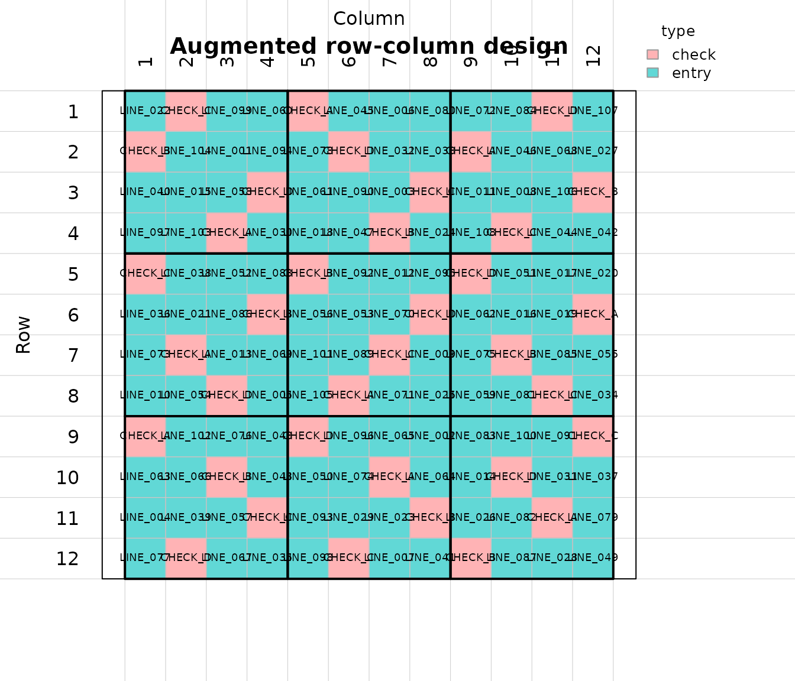
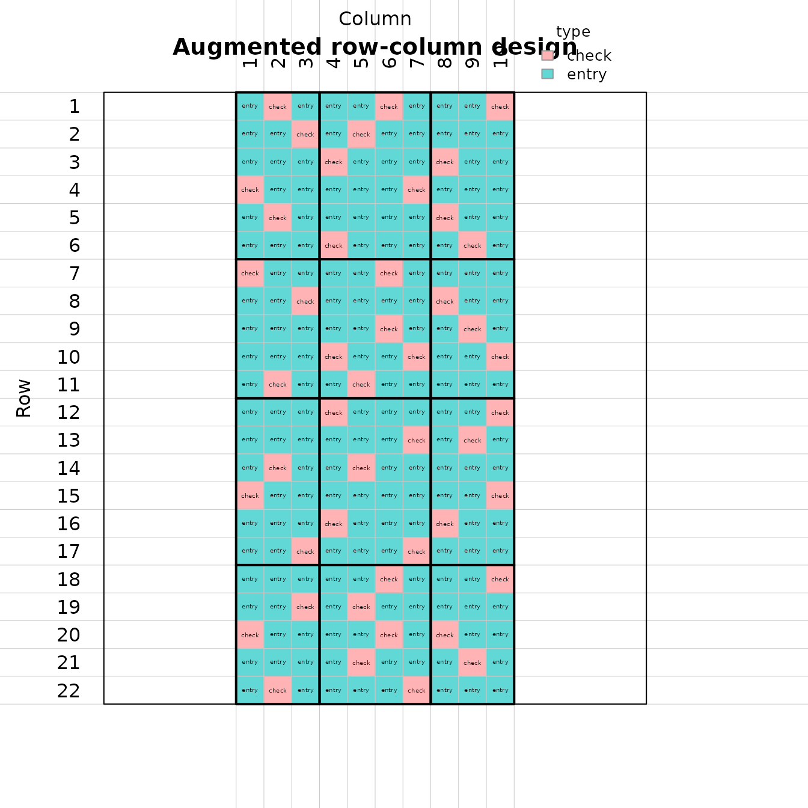
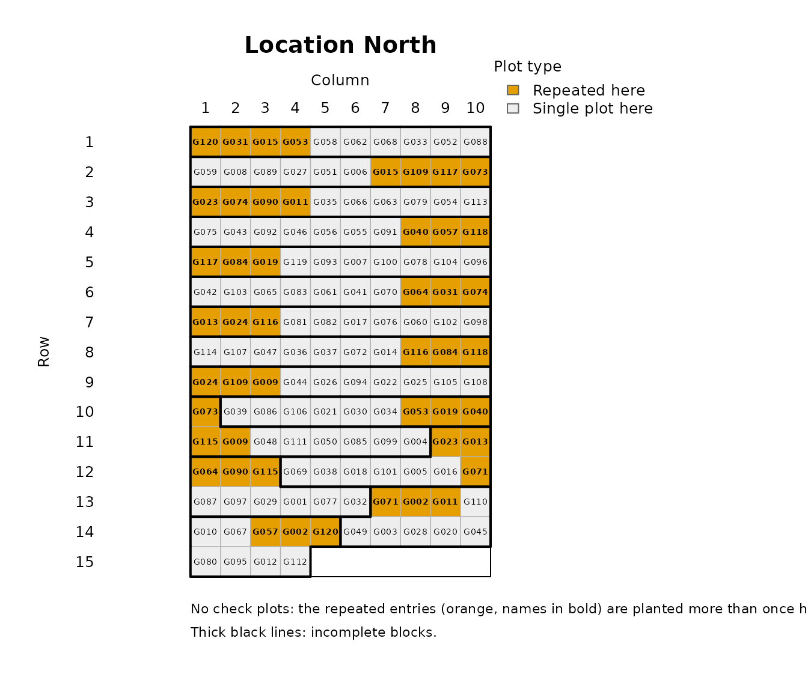
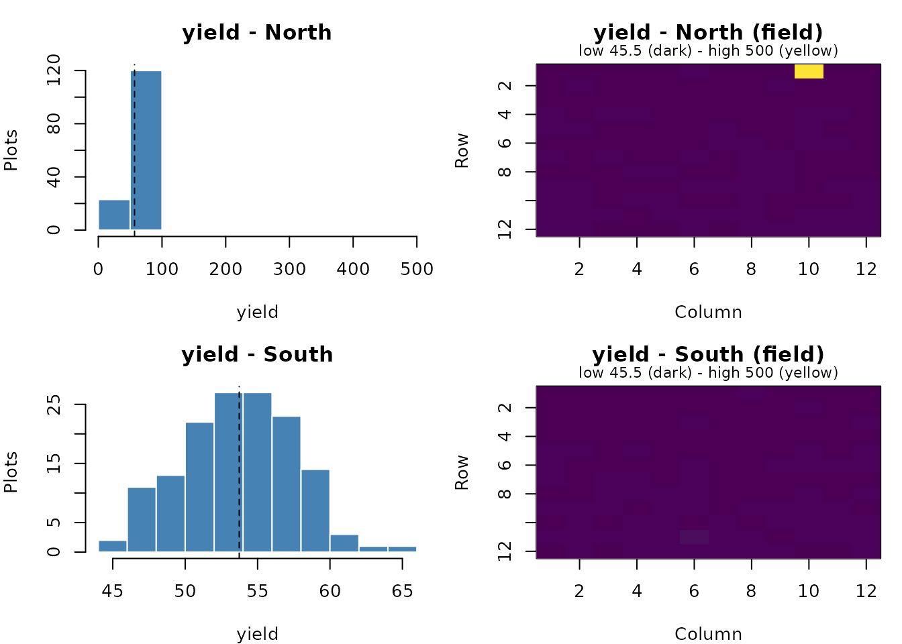
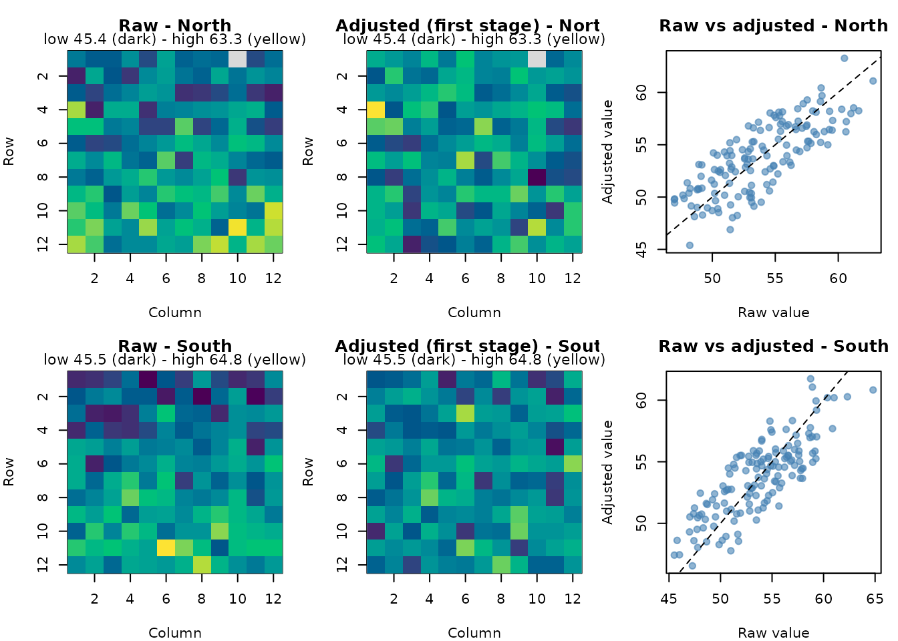
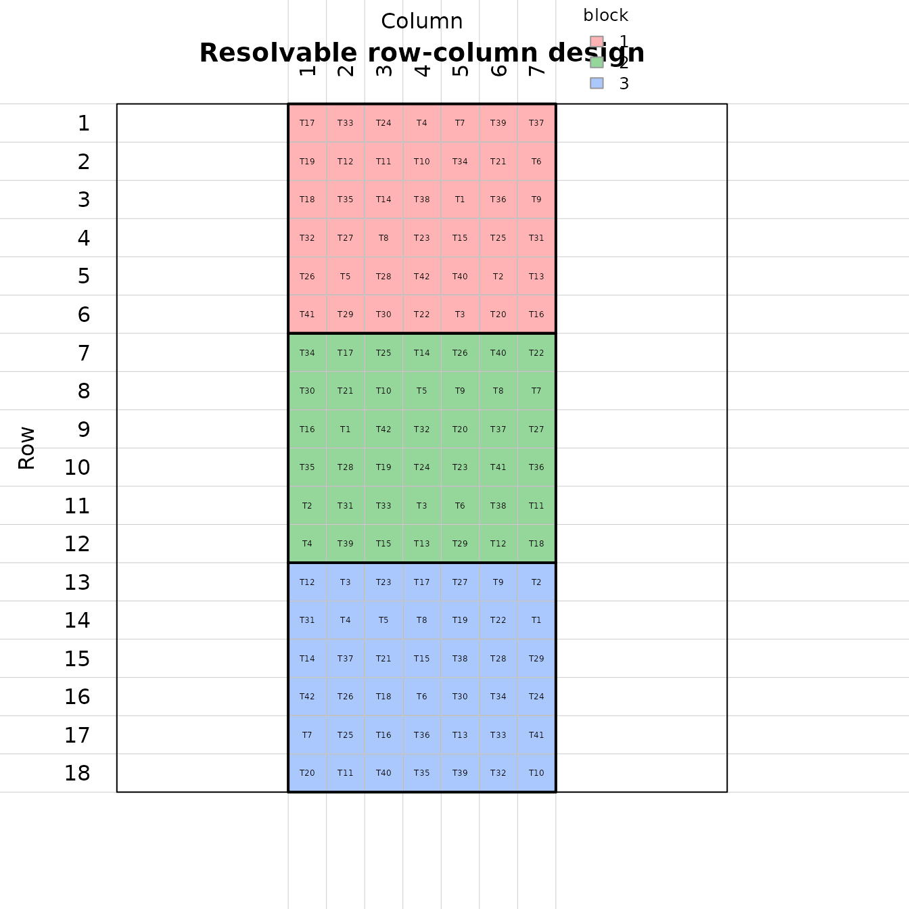

# Designing and analysing breeding trials with breedtools

`breedtools` designs and analyses plant breeding trials, from early
generations with a single plot per entry to fully replicated trials,
saves the designs directly into a ‘Breedbase’ database, and helps decide
which environments can be analysed together. This tutorial goes through
every design and analysis in the package, using simulated phenotypes.

``` r

library(breedtools)
```

### Which design?

| Situation | Design | Generate | Analyse |
|----|----|----|----|
| Seed for one plot per entry, one location | Augmented row-column design with replicated checks | [`augmented_row_column_design()`](https://chris263.github.io/breedtools/reference/augmented_row_column_design.md) | [`analyze_augmented_row_column_design()`](https://chris263.github.io/breedtools/reference/analyze_augmented_row_column_design.md) |
| Seed for one plot per entry per location, several locations | Augmented p-rep design (part of the entries repeated at each location, no checks needed) | [`augmented_prep_design()`](https://chris263.github.io/breedtools/reference/augmented_prep_design.md) | [`analyze_augmented_prep_design()`](https://chris263.github.io/breedtools/reference/analyze_augmented_prep_design.md), [`analyze_augmented_prep_two_stage()`](https://chris263.github.io/breedtools/reference/analyze_augmented_prep_two_stage.md) |
| Seed for every entry in every replicate | Resolvable (spatial) row-column design | [`resolvable_row_column_design()`](https://chris263.github.io/breedtools/reference/resolvable_row_column_design.md) | [`analyze_resolvable_row_column()`](https://chris263.github.io/breedtools/reference/analyze_resolvable_row_column.md) |
| Phenotypes from several trials in ‘Breedbase’ | Variance check and environment grouping | [`run_breedbase_variance_check()`](https://chris263.github.io/breedtools/reference/run_breedbase_variance_check.md), [`run_environment_stratification()`](https://chris263.github.io/breedtools/reference/run_environment_stratification.md) |  |
| A design ready to plant | Save it as a trial in a ‘Breedbase’ program and folder | [`save_breedbase()`](https://chris263.github.io/breedtools/reference/save_breedbase.md) |  |

Every design function returns a list with `summary`, the plot-level
`design` (the field book) and `breedbase_design` (the columns for a
‘Breedbase’ upload), and accepts `seed` for a reproducible randomization
and `output_file` for a tab-delimited copy. Every analysis returns
adjusted entry means (`adjusted_means`) ranked best first, with standard
errors, the mean standard error of a difference (`mean_sed`) and the 5%
least significant difference (`lsd_5pct`).

### Start with the information you know

Use
[`design_options()`](https://chris263.github.io/breedtools/reference/design_options.md)
when you know how many entries you have but have not settled on the
field dimensions, number of checks or replication. It proposes layouts
for augmented row-column, p-rep and fully replicated resolvable
row-column designs:

``` r

options <- design_options(n_entries = 100, n_locations = 3)
options[, c("option", "design", "n_checks", "rows_in_field", "cols_in_field", "n_reps",
             "plots_per_location", "error_df")]
#> # A tibble: 18 × 8
#>    option design  n_checks rows_in_field cols_in_field n_reps plots_per_location
#>     <int> <chr>      <int>         <int>         <int>  <int>              <dbl>
#>  1      1 augmen…        2             9            14      1                126
#>  2      2 augmen…        3             9            14      1                126
#>  3      3 augmen…        4             9            14      1                126
#>  4      4 augmen…        5             8            16      1                128
#>  5      5 augmen…        6            10            13      1                130
#>  6      6 augmen…        2             9            14      1                126
#>  7      7 prep           0            13             9     NA                115
#>  8      8 prep           0            10            12     NA                120
#>  9      9 prep           0             9            14     NA                125
#> 10     10 prep           0             7            19     NA                133
#> 11     11 prep           0            13             9     NA                115
#> 12     12 prep           0            12            10     NA                120
#> 13     13 resolv…        0            20            10      2                200
#> 14     14 resolv…        0            20            15      3                300
#> 15     15 resolv…        0            10            20      2                200
#> 16     16 resolv…        0            15            20      3                300
#> 17     17 resolv…        0            10            20      2                200
#> 18     18 resolv…        0            12            25      3                300
#> # ℹ 1 more variable: error_df <dbl>
```

`n_entries` counts test entries, excluding checks. To consider only
certain designs, use `design = c("augmented_row_column", "resolvable")`,
for example. Supply known constraints and leave the others unspecified:

``` r

fixed_options <- design_options(108, design = "augmented_row_column", n_checks = 4,
  rows = 12, cols = 12, n_candidates = 200)
fixed_options[, c("option", "rows_in_field", "cols_in_field", "rows_per_block",
                   "cols_per_block", "n_candidates", "check_plots", "error_df", "method")]
#> # A tibble: 6 × 9
#>   option rows_in_field cols_in_field rows_per_block cols_per_block n_candidates
#>    <int>         <int>         <int>          <int>          <int>        <int>
#> 1      1            12            12              4              4          200
#> 2      2            12            12             12              4          200
#> 3      3            12            12             12              6          200
#> 4      4            12            12              4             12          200
#> 5      5            12            12              6             12          200
#> 6      6            12            12             12             12          200
#> # ℹ 3 more variables: check_plots <dbl>, error_df <dbl>, method <chr>
design_options(42, design = "resolvable", cols = 7, n_reps = 3)
#> # A tibble: 4 × 27
#>   option design     n_entries n_checks rows_in_field cols_in_field n_locations
#>    <int> <chr>          <int>    <int>         <int>         <int>       <int>
#> 1      1 resolvable        42        0            18             7           1
#> 2      2 resolvable        42        0            21             7           1
#> 3      3 resolvable        42        0            24             7           1
#> 4      4 resolvable        42        0            27             7           1
#> # ℹ 20 more variables: n_reps <int>, rows_per_block <int>,
#> #   cols_per_block <int>, rows_per_rep <dbl>, cols_per_rep <int>,
#> #   block_size <int>, n_candidates <int>, checks_per_block <list>,
#> #   plots_per_location <dbl>, total_plots <dbl>, field_plots <dbl>,
#> #   unused_plots <dbl>, check_plots <int>, n_repeated <dbl>, n_blocks <dbl>,
#> #   error_df <dbl>, method <chr>, generator <chr>, arguments <list>, note <chr>
```

Rows and columns describe the entire field at one location, including
all replicates. A supplied dimension is an exact candidate size; a
vector such as `rows = c(12, 15, 18)` considers each size. `max_plots`
limits field area per location. `unused_plots` reports filler positions
or a partial final row. `min_error_df = 10`, for example, can exclude
layouts with little nominal error information.
`attr(options, "diagnostics")` explains why a requested design family
has no options within the search limits.

Choose an augmented row-column option and pass every setting explicitly
to
[`augmented_row_column_design()`](https://chris263.github.io/breedtools/reference/augmented_row_column_design.md).
This design family is identified by `"augmented_row_column"`; the
shorter name `"augmented"` is not used. The planner requires at least
one block row and one block column per distinct check: with four checks,
every suggested block is at least 4 rows by 4 columns. This leaves room
for one copy of each check in a distinct row and column of the block.

``` r

selected <- fixed_options[1, ]
entries <- sprintf("LINE_%03d", 1:108)
check_names <- c("CHECK_A", "CHECK_B", "CHECK_C", "CHECK_D")
planned_trial <- augmented_row_column_design(
  treatments       = entries,
  controls         = check_names,
  rows_in_field    = selected$rows_in_field,
  cols_in_field    = selected$cols_in_field,
  rows_per_block   = selected$rows_per_block,
  cols_per_block   = selected$cols_per_block,
  checks_per_block = selected$checks_per_block[[1]],
  method           = selected$method,
  n_candidates     = selected$n_candidates,
  seed             = 2026
)
check_design(planned_trial)
#> Checking the augmented row-column design
#>   [OK]   every plot used exactly once
#>   [OK]   every entry planted exactly once
#>   [OK]   every field row has a check
#>   [OK]   every field column has a check
#>   [OK]   check plots per block as requested
#>   [OK]   error df > 0 (6)
#>   [OK]   row, column and block effects estimable from the checks
#>   [OK]   checks spread evenly in each block (every check in full blocks)
#>   [OK]   even numbers of check plots in the rows and columns of each group
#>   [OK]   every check in each row and column with room for all checks
#>   [OK]   no checks next to each other inside a block (0 pairs)
#>   [OK]   no checks next to each other across block boundaries (0 pairs)
#>   [OK]   no check twice in a field row or column
```

`n_candidates = 200` is the search effort you choose. The planner
suggests the dimensions and block arrangement; it records your chosen
search effort alongside them. Include `checks_per_block` because options
that need extra check replication carry that allocation in this column.
It is `NULL` for complete blocks with one copy of every check.

For other design families, `selected$arguments[[1]]` supplies their
layout arguments for [`do.call()`](https://rdrr.io/r/base/do.call.html).
For p-rep, replace the placeholder locations with your location names.
For resolvable designs, include both entries and checks in the
generator’s `treatments`; both are fully replicated. The native
resolvable generator needs checks marked in `is_control` in its two
field-book tables if check status is needed for Breedbase.

The planner checks counts, block conditions and nominal error degrees of
freedom. It does not randomize a design or estimate its precision.
Generate your selected option and inspect its summary and
[`check_design()`](https://chris263.github.io/breedtools/reference/check_design.md)
results to assess connectivity and efficiency. Extra positions in
augmented layouts are assigned explicitly to extra check replication,
keeping the number of test entries exact.

A longer script that you can run section by section in RStudio ships
with the package:

``` r

file.edit(system.file("examples", "breedtools_workflow.R", package = "breedtools"))
```

## 1. Augmented row-column designs

Unreplicated entries are tested together with a few replicated checks.
Rows and columns are grouped into row groups and column groups, and each
intersection is a block that receives check plots. Row, column and block
effects are estimated from the checks and used to adjust the entries
(Federer, Nair and Raghavarao, 1975; Piepho and Williams, 2016).

### Plan the layout

Row, column and block effects are estimated from the check plots only,
so a layout must leave error degrees of freedom after estimating them.
Check this before you plant:

``` r

augmented_row_column_capacity(
  rows_in_field = 12, cols_in_field = 12,
  rows_per_block = 4, cols_per_block = 4,
  n_controls = 4
)
#> # A tibble: 1 × 17
#>   rows_in_field cols_in_field rows_per_block cols_per_block n_block_rows
#>           <int>         <int>          <int>          <int>        <int>
#> 1            12            12              4              4            3
#> # ℹ 12 more variables: n_block_cols <int>, n_blocks <int>, n_controls <int>,
#> #   total_plots <int>, check_plots <int>, entry_plots <int>, error_df <dbl>,
#> #   check_fraction <dbl>, min_rowgroup_slack <dbl>, min_colgroup_slack <dbl>,
#> #   every_row_has_check <lgl>, every_col_has_check <lgl>
```

`entry_plots` is the number of test entries that fit, and `error_df`
must be positive (Clarke and Stefanova, 2011, recommend about 50 when
the field is large enough). `min_rowgroup_slack` and
`min_colgroup_slack` are the conditions of Piepho and Williams (2016)
for the row-group and column-group sub-designs; negative values warn
that those sub-designs cannot be estimated on their own.

[`augmented_row_column_layouts()`](https://chris263.github.io/breedtools/reference/augmented_row_column_layouts.md)
lists analyzable layouts whose blocks have at least as many rows and
columns as checks, most entry plots first, so you can see the trade-off
between entry plots and error df. Give `n_entries` to keep only the
layouts that fit your entries, and `min_error_df` to require a minimum
precision:

``` r

augmented_row_column_layouts(rows_in_field = 12, cols_in_field = 12, n_controls = 2:5)
#> # A tibble: 9 × 9
#>   rows_per_block cols_per_block n_controls entry_plots error_df check_plots
#>            <int>          <int>      <int>       <int>    <dbl>       <int>
#> 1              4              4          4         108        6          36
#> 2              4              3          3         108        5          36
#> 3              3              4          3         108        5          36
#> 4              4              2          2         108        2          36
#> 5              2              4          2         108        2          36
#> 6              3              3          3          96       14          48
#> 7              3              2          2          96        9          48
#> 8              2              3          2          96        9          48
#> 9              2              2          2          72       23          72
#> # ℹ 3 more variables: n_blocks <int>, check_fraction <dbl>, method <chr>
augmented_row_column_layouts(12, 12, n_controls = 2:6, min_error_df = 6, n_entries = 100)
#> # A tibble: 1 × 10
#>   rows_per_block cols_per_block n_controls entry_plots error_df check_plots
#>            <int>          <int>      <int>       <int>    <dbl>       <int>
#> 1              4              4          4         108        6          36
#> # ℹ 4 more variables: n_blocks <int>, check_fraction <dbl>, method <chr>,
#> #   spare_plots <int>
```

`method` shows which construction
[`augmented_row_column_design()`](https://chris263.github.io/breedtools/reference/augmented_row_column_design.md)
will use for the layout (see below).

### Generate and inspect

``` r

rc <- augmented_row_column_design(
  treatments = sprintf("LINE_%03d", 1:108),
  controls = c("CHECK_A", "CHECK_B", "CHECK_C", "CHECK_D"),
  rows_in_field = 12, cols_in_field = 12,
  rows_per_block = 4, cols_per_block = 4,
  n_candidates = 200,
  seed = 2026
)
rc$summary[, c("method", "total_plots", "check_plots", "entry_plots",
               "error_df", "d_criterion")]
#> # A tibble: 1 × 6
#>   method total_plots check_plots entry_plots error_df d_criterion
#>   <chr>        <int>       <int>       <int>    <dbl>       <dbl>
#> 1 latin          144          36         108        6        2.08
head(rc$design)
#>   plots row col block rowgroup colgroup all_entries  type rep is_control
#> 1     1   1   1     1        1        1    LINE_022 entry   1          0
#> 2     2   1   2     1        1        1     CHECK_C check   1          1
#> 3     3   1   3     1        1        1    LINE_099 entry   1          0
#> 4     4   1   4     1        1        1    LINE_060 entry   1          0
#> 5     5   1   5     2        1        2     CHECK_A check   2          1
#> 6     6   1   6     2        1        2    LINE_045 entry   1          0
```

For regular layouts like this one, checks are placed with covering Latin
rectangles (`method = "latin"`): each block holds one plot of each
check, checks never share a row or column within a block, and every
field row and column contains a check:

``` r

checks <- rc$design[rc$design$is_control == 1, ]
table(checks$all_entries, checks$block)
#>          
#>           1 2 3 4 5 6 7 8 9
#>   CHECK_A 1 1 1 1 1 1 1 1 1
#>   CHECK_B 1 1 1 1 1 1 1 1 1
#>   CHECK_C 1 1 1 1 1 1 1 1 1
#>   CHECK_D 1 1 1 1 1 1 1 1 1
all(1:12 %in% checks$row) && all(1:12 %in% checks$col)
#> [1] TRUE
```

``` r

plot_augmented_row_column_design(rc, label = "all_entries", fill = "type")
```



[`check_design()`](https://chris263.github.io/breedtools/reference/check_design.md)
runs the standard checks of any design and prints one `[OK]` or `[FAIL]`
line per check; it works the same way for p-rep and resolvable
row-column designs. Add checks of your own with
[`check_result()`](https://chris263.github.io/breedtools/reference/check_result.md),
and count them with
[`check_summary()`](https://chris263.github.io/breedtools/reference/check_summary.md):

``` r

check_design(rc)
#> Checking the augmented row-column design
#>   [OK]   every plot used exactly once
#>   [OK]   every entry planted exactly once
#>   [OK]   every field row has a check
#>   [OK]   every field column has a check
#>   [OK]   check plots per block as requested
#>   [OK]   error df > 0 (6)
#>   [OK]   row, column and block effects estimable from the checks
#>   [OK]   checks spread evenly in each block (every check in full blocks)
#>   [OK]   even numbers of check plots in the rows and columns of each group
#>   [OK]   every check in each row and column with room for all checks
#>   [OK]   no checks next to each other inside a block (0 pairs)
#>   [OK]   no checks next to each other across block boundaries (0 pairs)
#>   [OK]   no check twice in a field row or column
check_result("all 108 entries in the field book", sum(rc$design$is_control == 0) == 108)
#>   [OK]   all 108 entries in the field book
check_summary()
#> 
#> 27 of 27 checks passed
#> 
#> By section:
#>  section                     checks passed failed notes
#>  augmented row-column design 26     26     0      0    
#>  (no section)                 1      1     0      0    
#> 
#> All checks are correct.
```

### Flexible layouts (Piepho and Williams, 2016)

Row and column groups need not be equal, and blocks can hold fewer check
plots than there are checks (incomplete blocks) or more (extra
replication). Such layouts use `method = "optimal"`: check labels are
allocated to blocks in a balanced way and the check plots are then
placed by a local search that maximizes the D-criterion of the
check-plot model, with spatial spread as a tie-breaker. This reproduces
Example 3 of Piepho and Williams (2016): 173 entries and 4 checks on 22
rows and 10 columns, with blocks of 3 to 5 check plots.

``` r

pb <- rbind(c(4, 5, 4), c(3, 5, 3), c(3, 5, 4), c(3, 5, 3))
augmented_row_column_capacity(
  n_controls = 4,
  rows_per_rowgroup = c(6, 5, 6, 5),
  cols_per_colgroup = c(3, 4, 3),
  checks_per_block = pb
)[, c("total_plots", "check_plots", "entry_plots", "error_df")]
#> # A tibble: 1 × 4
#>   total_plots check_plots entry_plots error_df
#>         <int>       <int>       <int>    <dbl>
#> 1         220          47         173        7

ex3 <- augmented_row_column_design(
  treatments = paste0("E", 1:173),
  controls = c("A", "B", "C", "D"),
  rows_per_rowgroup = c(6, 5, 6, 5),
  cols_per_colgroup = c(3, 4, 3),
  checks_per_block = pb,
  n_candidates = 3,
  seed = 1
)
ex3$summary[, c("method", "error_df", "d_criterion")]
#> # A tibble: 1 × 3
#>   method  error_df d_criterion
#>   <chr>      <dbl>       <dbl>
#> 1 optimal        7        1.94
table(ex3$design$block[ex3$design$is_control == 1])
#> 
#>  1  2  3  4  5  6  7  8  9 10 11 12 
#>  4  5  4  3  5  3  3  5  4  3  5  3
```

``` r

plot_augmented_row_column_design(ex3, label = "type", fill = "type")
```



A single number in `checks_per_block` gives the same number of check
plots in every block. With 6 checks and 5 check plots per block, every
block is an incomplete block of checks:

``` r

incomplete <- augmented_row_column_design(
  treatments = paste0("E", 1:279), controls = paste0("C", 1:6),
  rows_in_field = 18, cols_in_field = 18, rows_per_block = 6, cols_per_block = 6,
  checks_per_block = 5, n_candidates = 2, seed = 1
)
incomplete$summary[, c("method", "check_plots", "entry_plots", "error_df")]
#> # A tibble: 1 × 4
#>   method  check_plots entry_plots error_df
#>   <chr>         <int>       <int>    <dbl>
#> 1 optimal          45         279        1
```

Both methods follow the same placement rules as the paper’s designs: no
check plots next to each other inside a block, every check in a block
(or column, or row) that has room for all checks, and even numbers of
check plots in the rows and columns of each group. For regular layouts
the Latin construction is fast and usually at least as D-efficient;
`method = "optimal"` is used for layouts it cannot make (unequal groups,
incomplete blocks, extra check replication).

### Analyse

Simulate yields with a fertility gradient down the rows and a few lost
plots:

``` r

set.seed(1)
field <- rc$design
field$yield <- 60 + 0.8 * field$row - 0.3 * field$col +
  ifelse(field$is_control == 1, 5, 0) + rnorm(nrow(field), sd = 3)
field$yield[c(7, 50, 101)] <- NA

rc_fit <- analyze_augmented_row_column_design(field, response = "yield")
rc_fit
#> Augmented row-column design analysis
#> 
#>                                 Source  Df     Sum Sq    Mean Sq    F value
#> 1                           Row groups   2  738.60824 369.304121 67.1291587
#> 2       Rows, nested within row groups   9  167.06012  18.562235  3.3740951
#> 3                        Column groups   2  101.75036  50.875179  9.2476844
#> 4 Columns, nested within column groups   9   36.72282   4.080314  0.7416869
#> 5  Row groups x column groups (blocks)   4   23.90125   5.975313  1.0861447
#> 6                            Genotypes 109 1222.78810  11.218239  2.0391621
#> 7                                Error   5   27.50698   5.501397         NA
#> 8                      Corrected total 140 2318.33787         NA         NA
#>         Pr(>F) Significance
#> 1 0.0002442711           **
#> 2 0.0969140498             
#> 3 0.0208914865            *
#> 4 0.6722534865             
#> 5 0.4528421697             
#> 6 0.2171852806             
#> 7           NA             
#> 8           NA             
#> 
#> Top adjusted means (110 genotypes; see $adjusted_means):
#>  rank genotype n_observations adjusted_mean std_error
#>     1 LINE_097              1         74.71     5.383
#>     2 LINE_040              1         73.55     4.850
#>     3 LINE_073              1         71.55     4.994
#>     4 LINE_064              1         71.39     4.558
#>     5 LINE_063              1         71.07     5.066
#>     6 LINE_031              1         70.99     3.924
#>     7 LINE_105              1         70.06     4.513
#>     8 LINE_103              1         69.98     4.196
#>     9 LINE_108              1         69.94     5.542
#>    10 LINE_010              1         69.82     4.020
#> Mean SED = 6.774; LSD (5%) = 17.41
```

The model is that of Piepho and Williams (2016, Eq. 1): row groups, rows
within row groups, column groups, columns within column groups, blocks
and genotypes. The ANOVA degrees of freedom are those estimable from the
observed plots, so the F-tests stay valid with missing plots.

`rc_fit$adjusted_means` ranks the genotypes by their adjusted mean
(BLUE): the expected value of the genotype in an average plot of the
field. For an unreplicated entry, this is its plot value corrected for
the row, column and block effects of that plot, as estimated from the
checks. Rank and select on these, not on the raw values:

``` r

head(rc_fit$adjusted_means)
#> # A tibble: 6 × 8
#>    rank genotype type  is_control n_observations raw_mean adjusted_mean
#>   <int> <chr>    <chr>      <int>          <int>    <dbl>         <dbl>
#> 1     1 LINE_097 entry          0              1     65.2          74.7
#> 2     2 LINE_040 entry          0              1     64.0          73.6
#> 3     3 LINE_073 entry          0              1     67.1          71.5
#> 4     4 LINE_064 entry          0              1     69.9          71.4
#> 5     5 LINE_063 entry          0              1     67.2          71.1
#> 6     6 LINE_031 entry          0              1     69.7          71.0
#> # ℹ 1 more variable: std_error <dbl>
rc_fit$diagnostics[, c("anova_error_df", "sigma", "mean_sed", "lsd_5pct")]
#> # A tibble: 1 × 4
#>   anova_error_df sigma mean_sed lsd_5pct
#>            <int> <dbl>    <dbl>    <dbl>
#> 1              5  2.35     6.77     17.4
```

`std_error` includes the uncertainty in the spatial correction. With
only a few error df, as here, that uncertainty is large, which is a
reason to prefer layouts with more check plots.

### Mixed and spatial analyses

When blocks are not complete replicates of the checks, treating rows,
columns and blocks as random recovers inter-block information
(`random_blocks = TRUE`). Entries from one breeding population can also
be modelled as random with the checks fixed (`entries = "random"`),
which gives BLUPs. Both are fitted by REML with ‘lme4’; the ANOVA table
is always the fixed-effects table.

``` r

rc_random <- analyze_augmented_row_column_design(field, response = "yield",
                                                 random_blocks = TRUE)
rc_random$variance_components
#> # A tibble: 4 × 2
#>   component                         variance
#>   <chr>                                <dbl>
#> 1 rows within row groups              0.0111
#> 2 columns within column groups        0.741 
#> 3 blocks (row group x column group)   0.315 
#> 4 residual                            4.22
rc_blup <- analyze_augmented_row_column_design(field, response = "yield",
                                               random_blocks = TRUE,
                                               entries = "random")
head(rc_blup$adjusted_means)
#> # A tibble: 6 × 8
#>    rank genotype type  is_control n_observations raw_mean adjusted_mean
#>   <int> <chr>    <chr>      <int>          <int>    <dbl>         <dbl>
#> 1     1 CHECK_C  check          1              9     68.8          68.8
#> 2     2 CHECK_A  check          1              9     67.8          67.7
#> 3     3 CHECK_D  check          1              8     67.0          67.4
#> 4     4 CHECK_B  check          1              9     67.0          67.0
#> 5     5 LINE_086 entry          0              1     70.4          65.1
#> 6     6 LINE_067 entry          0              1     72.2          65.0
#> # ℹ 1 more variable: std_error <dbl>
rc_blup$message
#> [1] "Entry values are BLUPs (entries random); checks are BLUEs."
```

A smooth two-dimensional P-spline surface over the field can be added as
a spatial component with ‘SpATS’ (`spatial = TRUE`); rows, columns and
blocks are then random:

``` r

rc_spatial <- analyze_augmented_row_column_design(field, response = "yield",
                                                  spatial = TRUE)
rc_spatial$diagnostics[, c("model_type", "mean_sed", "spatial_effective_dim")]
#> # A tibble: 1 × 3
#>   model_type mean_sed spatial_effective_dim
#>   <chr>         <dbl>                 <dbl>
#> 1 spatial        3.05                  2.83
```

Compare `mean_sed` between the fixed, mixed and spatial fits to see
which model gives the most precise comparisons for your trial.

## 2. Augmented p-rep designs

In a multi-location trial without checks, every entry is planted once at
every location, and a subset of the entries is repeated at each location
to estimate the error and the block effects (Williams, Piepho and
Whitaker, 2011). Typically every entry is repeated at exactly one
location.

### Generate

``` r

prep <- augmented_prep_design(
  treatments = sprintf("G%03d", 1:120),
  locations = c("North", "Central", "South"),
  block_size = 10,
  prep_prop = 0.2,
  field_cols = 10,
  n_candidates = 200,
  seed = 2026
)
prep$summary[, c("n_locations", "n_entries", "n_plots", "n_blocks",
                 "max_pairwise_concurrence", "n_disconnected_locations",
                 "efficiency_factor")]
#> # A tibble: 1 × 7
#>   n_locations n_entries n_plots n_blocks max_pairwise_concurrence
#>         <int>     <int>   <int>    <int>                    <int>
#> 1           3       120     432       45                        1
#> # ℹ 2 more variables: n_disconnected_locations <int>, efficiency_factor <dbl>
table(table(prep$design$all_entries))
#> 
#>  3  4 
#> 48 72
```

Each location gets 20% of the entries as extra plots. The design search
(`method = "search"`, the default):

- spreads the p-rep plots evenly over the blocks;
- places them so that they connect all blocks of a location, so each
  location can also be analysed on its own (a warning is given when
  there are too few p-rep plots for that);
- keeps pairs of entries from sharing a block more than once
  (`max_pairwise_concurrence = 1` is a (0,1)-design);
- returns the most efficient of several optimal candidates
  (`efficiency_factor` is the average efficiency factor of the paper;
  compare it only between designs with the same number of plots).

The search accepts any proportion of p-rep entries (`prep_prop` or
`n_duplicate_per_location`, which can differ between locations), more
than two plots per repeated entry (`replications_per_repeated_entry`), a
fixed number of blocks, and a resolvable layout in which each location
is split into replicates that each hold every p-rep entry once:

``` r

prep_res <- augmented_prep_design(
  treatments = sprintf("G%03d", 1:60),
  locations = c("A", "B"),
  block_size = 8,
  n_duplicate_per_location = c(A = 18, B = 12),
  resolvable = TRUE,
  field_cols = 8,
  seed = 1
)
pp <- prep_res$design[prep_res$design$entry_type == "p_rep_entry_at_this_location", ]
table(pp$location, pp$replicate)
#>    
#>      1  2
#>   A 18 18
#>   B 12 12
```

``` r

plot_augmented_prep_design(prep, locations = "North", fill = "entry_type")
```



### Algebraic constructions

Williams, Piepho and Whitaker (2011) also give two algebraic
constructions in which every entry is duplicated at exactly one location
and each location is a resolvable two-replicate design with `m` p-rep
entries in every block (final block size `(l + 1) m / 2`).
[`augmented_prep_parameters()`](https://chris263.github.io/breedtools/reference/augmented_prep_parameters.md)
lists the feasible settings, as in Table 3 of the paper:

``` r

augmented_prep_parameters(n_treatments = 120, n_locations = 3, max_block_size = 10)
#> # A tibble: 6 × 11
#>   method     m     s block_size min_block_size blocks_per_location
#>   <chr>  <int> <int>      <int>          <int>               <int>
#> 1 alpha      2    20          4              4                  40
#> 2 alpha      3    14          6              5                  28
#> 3 alpha      4    10          8              8                  20
#> 4 alpha      5     8         10             10                  16
#> 5 alpha2     2    20          4              4                  40
#> 6 alpha2     4    10          8              8                  20
#> # ℹ 5 more variables: plots_per_location <int>, duplicated_per_location <int>,
#> #   dummies <int>, feasible <lgl>, note <chr>
```

`method = "alpha"` uses partial alpha-arrays (Sections 2.1-2.2 of the
paper) and `method = "alpha2"` uses augmented alpha(2)-arrays (Section
2.4; even `m` and an odd number of blocks per replicate). The number of
p-rep entries per block is set with `n_prep_per_block`, or chosen as the
largest that fits in `block_size`:

``` r

prep_alpha <- augmented_prep_design(
  treatments = sprintf("G%03d", 1:120),
  locations = c("North", "Central", "South"),
  method = "alpha",
  block_size = 10,
  field_cols = 10,
  seed = 2026
)
prep_alpha2 <- augmented_prep_design(
  treatments = paste0("G", 1:42),
  locations = c("L1", "L2", "L3"),
  method = "alpha2",
  block_size = 4,
  seed = 1
)
rbind(
  search = prep$summary[, c("method", "n_plots", "n_blocks", "max_pairwise_concurrence", "efficiency_factor")],
  alpha = prep_alpha$summary[, c("method", "n_plots", "n_blocks", "max_pairwise_concurrence", "efficiency_factor")],
  alpha2 = prep_alpha2$summary[, c("method", "n_plots", "n_blocks", "max_pairwise_concurrence", "efficiency_factor")]
)
#> # A tibble: 3 × 5
#>   method n_plots n_blocks max_pairwise_concurrence efficiency_factor
#> * <chr>    <int>    <int>                    <int>             <dbl>
#> 1 search     432       45                        1             0.878
#> 2 alpha      480       48                        1             0.888
#> 3 alpha2     168       42                        1             0.717
```

The `prep_alpha2` design is Example 3 of the paper: 42 entries in three
locations, each with 14 blocks of 4 plots.

### Analyse and rank

``` r

set.seed(2)
genotype_effect <- setNames(rnorm(120, sd = 4), sprintf("G%03d", 1:120))
block_id <- interaction(prep$design$location, prep$design$block)
block_effect <- setNames(rnorm(nlevels(block_id), sd = 2), levels(block_id))

trial <- prep$design
trial$yield <- 50 + c(North = 0, Central = 8, South = -5)[trial$location] +
  block_effect[as.character(block_id)] +
  genotype_effect[trial$all_entries] + rnorm(nrow(trial), sd = 3)

prep_fit <- analyze_augmented_prep_design(trial, response = "yield")
prep_fit
#> Augmented p-rep design analysis
#> 
#>                            Source  Df    Sum Sq     Mean Sq    F value
#> 1                       Locations   2 12986.999 6493.499267 735.432792
#> 2 Blocks, nested within locations  42  2942.514   70.059868   7.934755
#> 3                       Genotypes 119  8887.115   74.681635   8.458201
#> 4                           Error 268  2366.304    8.829494         NA
#> 5                 Corrected total 431 27182.932          NA         NA
#>          Pr(>F) Significance
#> 1 1.494228e-109           **
#> 2  5.118116e-28           **
#> 3  2.794584e-47           **
#> 4            NA             
#> 5            NA             
#> 
#> Top adjusted means (120 genotypes; see $adjusted_means):
#>  rank genotype n_observations adjusted_mean std_error
#>     1     G106              4         61.88     1.588
#>     2     G046              3         61.47     1.833
#>     3     G021              4         61.42     1.592
#>     4     G015              4         60.63     1.582
#>     5     G009              4         60.20     1.584
#>     6     G052              4         60.15     1.583
#>     7     G062              4         59.96     1.582
#>     8     G024              4         59.89     1.582
#>     9     G044              3         59.81     1.829
#>    10     G108              4         59.40     1.585
#> Mean SED = 2.388; LSD (5%) = 4.701
```

The model is `location + block(location) + genotype`; for resolvable
designs replicates within locations are added and blocks are nested in
replicates. Adjusted means correct for the location and block of every
plot. Because the data are simulated, we can check that they track the
true genotype effects more closely than the raw means do:

``` r

means <- prep_fit$adjusted_means
c(
  raw = cor(means$raw_mean, genotype_effect[means$genotype]),
  adjusted = prediction_accuracy(prep_fit, genotype_effect)
)
#>       raw  adjusted 
#> 0.9100724 0.9408252
```

[`prediction_accuracy()`](https://chris263.github.io/breedtools/reference/prediction_accuracy.md)
is the correlation between the adjusted means and the true values; use
`method = "spearman"` to measure how well the ranking is recovered.

Each location can also be analysed on its own (the paper’s per-location
incomplete-block analysis), because the design keeps every location
connected:

``` r

north <- analyze_augmented_prep_design(trial[trial$location == "North", ], response = "yield")
north$anova_formatted
#>                            Source  Df    Sum Sq  Mean Sq  F value     Pr(>F)
#> 1                       Locations   0    0.0000       NA       NA         NA
#> 2 Blocks, nested within locations  14  621.1514 44.36796 4.112581 0.01501557
#> 3                       Genotypes 119 3284.8161 27.60350 2.558640 0.05146011
#> 4                           Error  10  107.8835 10.78835       NA         NA
#> 5                 Corrected total 143 4013.8510       NA       NA         NA
#>   Significance
#> 1             
#> 2            *
#> 3             
#> 4             
#> 5
```

### Genotype-by-location interaction

When locations are a sample of environments, add the interaction back at
the analysis stage. `genotype_by_location = "random"` fits it as a
random effect by REML (with ‘lme4’) and reports the variance components;
`genotype_by_location = "fixed"` fits it as a fixed effect, so the error
comes from the p-rep entries only.

``` r

prep_gxl <- analyze_augmented_prep_design(trial, response = "yield",
                                          genotype_by_location = "random")
#> boundary (singular) fit: see help('isSingular')
prep_gxl$variance_components
#> # A tibble: 2 × 2
#>   component           variance
#>   <chr>                  <dbl>
#> 1 genotype x location     0   
#> 2 residual                8.83
```

``` r

prep_gxl_fixed <- analyze_augmented_prep_design(trial, response = "yield",
                                                genotype_by_location = "fixed")
prep_gxl_fixed$anova_formatted
#>                            Source  Df     Sum Sq     Mean Sq     F value
#> 1                       Locations   2 12986.9985 6493.499267 688.5905234
#> 2 Blocks, nested within locations  42  2942.5144   70.059868   7.4293627
#> 3                       Genotypes 119  8887.1146   74.681635   7.9194690
#> 4             Genotype x location 238  2083.4004    8.753783   0.9282779
#> 5                           Error  30   282.9039    9.430132          NA
#> 6                 Corrected total 431 27182.9319          NA          NA
#>         Pr(>F) Significance
#> 1 8.542189e-26           **
#> 2 8.219382e-08           **
#> 3 6.428328e-09           **
#> 4 6.347421e-01             
#> 5           NA             
#> 6           NA
```

### Two-stage analysis: heterogeneous variances and spatial trends

Locations rarely have the same error variance, and fields often have
smooth fertility trends.
[`analyze_augmented_prep_two_stage()`](https://chris263.github.io/breedtools/reference/analyze_augmented_prep_two_stage.md)
first analyses every location on its own (stage 1), then combines the
location means weighted by their precision with a REML
genotype-by-location variance (stage 2; Möhring and Piepho, 2009), so
noisy locations count less:

``` r

trial_het <- trial
noisy <- trial_het$location == "South"
trial_het$yield[noisy] <- trial_het$yield[noisy] + rnorm(sum(noisy), sd = 6)

two <- analyze_augmented_prep_two_stage(trial_het, response = "yield")
two
#> Two-stage augmented p-rep analysis
#> Stage 1: blocks model per location; stage 2: full weighting, genotype x location random
#> 
#> Locations:
#>  location n_plots n_genotypes residual_variance residual_df mean_sed
#>   Central     144         120             4.808          10    3.923
#>     North     144         120            10.788          10    5.958
#>     South     144         120            37.517          10   11.152
#> 
#> Hartley Fmax = 7.80 (5% critical value 4.83): error variances differ between locations
#> 
#> Stage-2 variance components:
#>            component variance
#>  genotype x location    1.733
#> 
#> Top adjusted means (120 genotypes):
#>  rank genotype n_locations adjusted_mean std_error
#>     1     G046           3         64.09     2.122
#>     2     G021           3         62.51     2.039
#>     3     G062           3         62.21     2.023
#>     4     G106           3         61.58     2.032
#>     5     G097           3         61.06     1.819
#>     6     G015           3         61.02     1.903
#>     7     G052           3         60.36     1.813
#>     8     G024           3         60.00     1.896
#>     9     G009           3         59.27     1.902
#>    10     G003           3         59.22     2.137
#> Mean SED = 2.826; LSD (5%) = 5.568
```

`weighting = "full"` (default) uses the full covariance of the stage-1
means, `"diagonal"` only their variances, and `"none"` an unweighted
analysis:

``` r

two_diag <- analyze_augmented_prep_two_stage(trial_het, response = "yield", weighting = "diagonal")
two_none <- analyze_augmented_prep_two_stage(trial_het, response = "yield", weighting = "none")
# Correlation with the true genotype values (known because the data are simulated):
c(full = prediction_accuracy(two, genotype_effect),
  diagonal = prediction_accuracy(two_diag, genotype_effect),
  none = prediction_accuracy(two_none, genotype_effect))
#>      full  diagonal      none 
#> 0.9012235 0.8865807 0.8520058
```

With `stage1 = "spatial"`, each location is fitted with a
two-dimensional P-spline surface over rows and columns using the ‘SpATS’
package; this needs the field coordinates from `field_cols`:

``` r

two_spatial <- analyze_augmented_prep_two_stage(trial_het, response = "yield",
                                                stage1 = "spatial")
two_spatial$locations[, c("location", "residual_variance", "spatial_effective_dim")]
#> # A tibble: 3 × 3
#>   location residual_variance spatial_effective_dim
#>   <chr>                <dbl>                 <dbl>
#> 1 Central               2.92                  6.16
#> 2 North                 4.53                 12.2 
#> 3 South                26.2                   3.69
```

### Trait plots, outliers and two-stage analysis for any design

Before the analysis, look at the trait and remove outliers.
[`plot_trait()`](https://chris263.github.io/breedtools/reference/plot_trait.md)
draws a histogram and a field map per location;
[`remove_outliers()`](https://chris263.github.io/breedtools/reference/remove_outliers.md)
applies the IQR rule (values beyond or , within each location), sets
them to `NA` and lists every plot and value removed:

``` r

sites <- c("North", "South")
met <- do.call(rbind, lapply(1:2, function(i) {
  d <- augmented_row_column_design(paste0("G", 1:108), paste0("C", 1:4), 12, 12, 4, 4,
                                   n_candidates = 5, seed = i)$design
  d$location <- sites[i]
  d
}))
set.seed(4)
g <- setNames(rnorm(112, sd = 3), c(paste0("G", 1:108), paste0("C", 1:4)))
met$yield <- 50 + g[met$all_entries] + 0.6 * met$row + rnorm(nrow(met))
met$yield[10] <- 500                      # a typing error
plot_trait(met, "yield")
```



``` r

clean <- remove_outliers(met, "yield")
#> Removed 1 of 288 values as outliers (outside Q1 - 1.5 IQR and Q3 + 1.5 IQR, within each location):
#>  location plots all_entries row col trait value lower upper side
#>     North    10        G102   1  10 yield   500 42.58 65.09 high
```

[`analyze_two_stage()`](https://chris263.github.io/breedtools/reference/analyze_two_stage.md)
analyses every location on its own (stage 1: a SpATS spatial model, or
the design’s own model with `stage1 = "design"`) and combines the
locations weighted by their precision (stage 2). It works for augmented
row-column, p-rep and resolvable row-column designs.
[`compare_first_stage()`](https://chris263.github.io/breedtools/reference/compare_first_stage.md)
shows how the first stage changed the plot values:

``` r

two <- analyze_two_stage(clean, "yield", stage1 = "design")
two
#> Two-stage analysis
#> Stage 1: design model per location; stage 2: full weighting, genotype x location random
#> 
#> Locations:
#>  location         stage1_model n_plots n_genotypes residual_variance
#>     North augmented row-column     143         111            0.8870
#>     South augmented row-column     144         112            0.8625
#>  residual_df mean_sed
#>            6    2.364
#>            6    2.023
#> 
#> Hartley Fmax = 1.03 (5% critical value 5.79): no evidence of heterogeneity
#> 
#> Stage-2 variance components:
#>            component variance
#>  genotype x location  0.03368
#> 
#> Top adjusted means (112 genotypes):
#>  rank genotype n_locations adjusted_mean std_error
#>     1      G97           2         61.43    0.7917
#>     2       G9           2         60.66    0.7982
#>     3      G55           2         59.70    0.7900
#>     4     G107           2         59.40    0.7885
#>     5      G64           2         59.09    0.7974
#>     6      G23           2         58.60    0.7934
#>     7       G5           2         58.45    0.8060
#>     8      G99           2         58.34    0.8013
#>     9      G43           2         58.00    0.7926
#>    10      G41           2         57.61    0.7905
#> Mean SED = 1.111; LSD (5%) = 2.202
cmp <- compare_first_stage(two)
#> Raw versus first-stage adjusted values:
#>  location plots cor_raw_adjusted sd_raw sd_adjusted genotype_rank_cor
#>     North   143            0.775   3.67        3.37             0.764
#>     South   144            0.810   3.83        3.10             0.786
#>  top10pct_kept
#>          0.417
#>          0.667
#> (genotype_rank_cor: Spearman correlation of genotype means; top10pct_kept: share of the raw top 10% still in the adjusted top 10%)
```



### Single-stage analysis as an alternative

To fit all locations in one model, pass the cleaned plot observations
directly to
[`analyze_single_stage()`](https://chris263.github.io/breedtools/reference/analyze_single_stage.md).
This route does not require
[`analyze_two_stage()`](https://chris263.github.io/breedtools/reference/analyze_two_stage.md)
or any first-stage fit. Here `clean` is the multi-location field data
prepared above:

``` r

one <- analyze_single_stage(
  clean, "yield", genotype_col = "all_entries", location_col = "location",
  spatial = requireNamespace("SpATS", quietly = TRUE)
)
one
#> Single-stage analysis (spatial (SpATS)): 287 plots, 2 trials, 112 genotypes
#> 
#> Variance components:
#>                 component  variance
#>  blocks within replicates 0.0001921
#>          genotype x trial 0.0653228
#>                  residual 0.7614811
#> 
#> Top adjusted means (112 genotypes):
#>  rank genotype n_locations adjusted_mean std_error
#>     1      G97           2         62.65    0.7335
#>     2       G9           2         61.04    0.7362
#>     3      G55           2         60.07    0.7778
#>     4      G64           2         59.52    0.7645
#>     5     G107           2         59.32    0.7265
#>     6      G43           2         59.30    0.7429
#>     7       G5           2         59.03    0.7357
#>     8      G23           2         58.96    0.7773
#>     9      G10           2         58.48    0.7608
#>    10      G17           2         58.44    0.7331
#> Mean SED = 0.9322
one$variance_components
#> # A tibble: 3 × 2
#>   component                variance
#>   <chr>                       <dbl>
#> 1 blocks within replicates 0.000192
#> 2 genotype x trial         0.0653  
#> 3 residual                 0.761
single_values <- second_stage_values(one, trait = "fresh root yield")
head(single_values)
#> # A tibble: 6 × 2
#>   accession `fresh root yield`
#>   <chr>                  <dbl>
#> 1 G97                     62.7
#> 2 G9                      61.0
#> 3 G55                     60.1
#> 4 G64                     59.5
#> 5 G107                    59.3
#> 6 G43                     59.3
```

[`second_stage_values()`](https://chris263.github.io/breedtools/reference/second_stage_values.md)
formats the genotype means of either kind of fit; it performs no
additional analysis. The single-stage model shares one residual variance
across locations, while the weighted two-stage route uses the precision
estimated at each location. Save the single-stage means as their own
analysis project:

``` r

save_breedbase_analysis(single_values, con, analysis_name = "MET_2026_single_stage",
  program = "IITA", description = "Single-stage analysis of all field plots",
  estimate = if (isTRUE(one$input$spatial)) "spatial" else "blue")
```

## 3. Resolvable row-column designs

When there is enough seed to replicate every entry, a resolvable
row-column design places each treatment once in every replicate of `k`
rows and `s` columns (Williams, John and Whitaker, 2006). The search
first maximizes the average efficiency factor of the row-column design
and of its row and column components, then the spatial efficiency factor
of the two-dimensional linear variance (LV + RC) model, which spreads
treatments over neighbours and edge plots without needing prior values
for spatial parameters. `latinize = TRUE` builds a latinized design for
contiguous replicates, so that no treatment appears twice in a long
column.

``` r

rrc <- resolvable_row_column_design(
  treatments = paste0("T", 1:42),
  n_reps = 3,
  rows_per_rep = 6,
  cols_per_rep = 7,
  latinize = TRUE,
  n_starts = 1,
  seed = 1
)
rrc$summary[, c("efficiency_rc", "efficiency_rows", "efficiency_cols",
                "efficiency_spatial", "upper_bound_spatial", "latin_ok")]
#> # A tibble: 1 × 6
#>   efficiency_rc efficiency_rows efficiency_cols efficiency_spatial
#>           <dbl>           <dbl>           <dbl>              <dbl>
#> 1         0.682           0.840           0.811              0.919
#> # ℹ 2 more variables: upper_bound_spatial <dbl>, latin_ok <lgl>
```

``` r

plot_resolvable_row_column_design(rrc)
```



Other options: replicates placed side by side
(`replicate_layout = "horizontal"`, giving long rows), t-latinized
designs (`latin_t`, latinization within groups of `t` adjacent
replicates), and fewer treatments than plots per replicate (the
remaining plots become fillers, as in Example 1 of the paper with 59
provenances in replicates of 60 plots):

``` r

provenances <- resolvable_row_column_design(
  treatments = paste0("P", 1:59), n_reps = 4, rows_per_rep = 6, cols_per_rep = 10,
  latinize = TRUE, n_starts = 1, n_iter = 2000, seed = 1
)
provenances$summary[, c("n_treatments", "n_fillers", "efficiency_rc",
                        "efficiency_spatial", "latin_ok")]
#> # A tibble: 1 × 5
#>   n_treatments n_fillers efficiency_rc efficiency_spatial latin_ok
#>          <int>     <int>         <dbl>              <dbl> <lgl>   
#> 1           59         1         0.728              0.945 TRUE
```

### Evaluate a design

[`resolvable_row_column_efficiency()`](https://chris263.github.io/breedtools/reference/resolvable_row_column_efficiency.md)
evaluates any resolvable row-column design, including one produced
elsewhere: the efficiency factors, the spatial upper bound, treatment
neighbours and edge positions, and, given assumed parameters, the
average pairwise variance under an autoregressive model (the criterion
used in Section 4 of the paper to compare designs):

``` r

eff <- resolvable_row_column_efficiency(
  rrc, ar = list(eta_r = 35, eta_c = 60, psi = 10, rho_r = 0.5, rho_c = 0.5)
)
eff[c("efficiency_rc", "efficiency_spatial", "upper_bound_spatial", "ar_criterion")]
#> $efficiency_rc
#> [1] 0.6823223
#> 
#> $efficiency_spatial
#> [1] 0.9190266
#> 
#> $upper_bound_spatial
#> [1] 0.9268293
#> 
#> $ar_criterion
#> [1] 2.406235
head(eff$neighbours)
#> # A tibble: 6 × 6
#>   treatment row_neighbours col_neighbours neighbours reps_on_edge reps_in_corner
#>   <chr>              <int>          <int>      <int>        <int>          <int>
#> 1 T17                    5              3          8            3              1
#> 2 T33                    6              5         11            1              0
#> 3 T24                    5              5         10            2              0
#> 4 T4                     5              4          9            2              1
#> 5 T7                     4              5          9            3              0
#> 6 T39                    6              3          9            3              0
```

An existing design (for example from CycDesigN) can be laid out,
exported and analysed with `start_design`; with `n_iter = 1` and
`spatial = FALSE` it is kept as it is:

``` r

kept <- resolvable_row_column_design(paste0("T", 1:42), 3, 6, 7,
                                     start_design = rrc$design,
                                     n_iter = 1, spatial = FALSE)
all.equal(kept$summary$efficiency_rc, rrc$summary$efficiency_rc)
#> [1] TRUE
```

### Analyse

[`analyze_resolvable_row_column()`](https://chris263.github.io/breedtools/reference/analyze_resolvable_row_column.md)
fits, by REML, the standard row-column mixed model (`model = "rc"`:
replicates and treatments fixed, rows and columns within replicates
random), the two-dimensional linear variance model (`"lv"`, LV + RC) and
rows and columns plus a separable AR1 x AR1 process (`"ar"`, AR + RC).
With `compare = TRUE` (default) the sequence of models is compared by
REML deviance, the paper’s way of deciding whether spatial terms are
needed. For latinized designs, the long columns can be fitted as fixed
effects (`long_col`):

``` r

set.seed(3)
rrc_trial <- rrc$design
rrc_trial$y <- 20 + 2 * sin(rrc_trial$row / 3) + rnorm(nrow(rrc_trial))
rrc_fit <- analyze_resolvable_row_column(rrc_trial, response = "y", model = "lv",
                                         long_col = "long_col")
rrc_fit$model_comparison[, c("model", "n_variance_parameters", "deviance", "AIC", "lrt_p_value")]
#> # A tibble: 5 × 5
#>   model                         n_variance_parameters deviance   AIC lrt_p_value
#>   <chr>                                         <int>    <dbl> <dbl>       <dbl>
#> 1 RC                                                3     210.  216.     NA     
#> 2 RC + LV (single phi)                              4     205.  213.      0.0237
#> 3 RC + LV (phi_r, phi_c)                            5     205.  215.      0.0771
#> 4 RC + LV (phi_r, phi_c, phi_r…                     6     202.  214.      0.116 
#> 5 RC + AR1 x AR1                                    6     203.  215.     NA
rrc_fit$variance_parameters
#> # A tibble: 7 × 2
#>   parameter       estimate
#>   <chr>              <dbl>
#> 1 sigma2            0.478 
#> 2 eta_r             8.23  
#> 3 eta_c             0.840 
#> 4 phi_r             1.58  
#> 5 phi_c             1.78  
#> 6 row_variance      0.562 
#> 7 column_variance   0.0669
head(rrc_fit$adjusted_means)
#> # A tibble: 6 × 5
#>    rank genotype n_observations adjusted_mean std_error
#>   <int> <chr>             <int>         <dbl>     <dbl>
#> 1     1 T34                   3          21.4      4.51
#> 2     2 T40                   3          21.0      4.51
#> 3     3 T25                   3          20.9      4.51
#> 4     4 T19                   3          20.9      4.51
#> 5     5 T35                   3          20.7      4.51
#> 6     6 T1                    3          20.7      4.51
```

`row_variance` and `column_variance` are the variance components of rows
and columns within replicates. `equal_phi = TRUE` uses one spatial
parameter for rows and columns (square plots), and `lv_terms` adds the
row-column interaction term `phi_rc`.

## 4. Multi-environment trials from ‘Breedbase’

Before combining trials, check that their error variances are similar
and group environments with a similar ranking of genotypes. The package
ships an example ‘Breedbase’ phenotype file with four trials.

``` r

pheno_file <- system.file("extdata", "breedbase_pheno.csv", package = "breedtools")
raw <- read_breedbase_file(pheno_file)
dim(raw)
#> [1] 96 14
table(raw$locationName)
#> 
#> Geneva Ibadan Ithaca Ubiaja 
#>     24     24     24     24
```

[`read_breedbase_file()`](https://chris263.github.io/breedtools/reference/read_breedbase_file.md)
reads `.csv`, `.txt`, `.xls` and `.xlsx` files (all non-empty sheets of
a workbook are combined). Column names are detected automatically;
[`prepare_breedbase_pheno()`](https://chris263.github.io/breedtools/reference/prepare_breedbase_pheno.md)
selects the trait and the design columns, and
[`analyze_environment_anova()`](https://chris263.github.io/breedtools/reference/analyze_environment_anova.md)
gives one ANOVA per environment:

``` r

trait <- "fresh root yield|CO_334:0000013"
pheno <- prepare_breedbase_pheno(raw, trait_col = trait)
env_anova <- analyze_environment_anova(pheno)
env_anova[, c("environment", "n_genotypes", "ms_genotype", "ms_error", "mean", "cv_percent")]
#> # A tibble: 4 × 6
#>   environment n_genotypes ms_genotype ms_error  mean cv_percent
#>   <chr>             <int>       <dbl>    <dbl> <dbl>      <dbl>
#> 1 Geneva               12        20.6     1.14  31.5       3.39
#> 2 Ibadan               12        39.7     6.45  22.1      11.5 
#> 3 Ithaca               12        14.3     1.25  27.7       4.04
#> 4 Ubiaja               12        54.3     4.78  24.3       9.02
```

### Homogeneity of error variances

[`run_breedbase_variance_check()`](https://chris263.github.io/breedtools/reference/run_breedbase_variance_check.md)
applies Hartley’s Fmax test (with a simulated critical value that allows
different error df) to all environments and finds the largest groups of
environments whose error variances are compatible:

``` r

variance_check <- run_breedbase_variance_check(pheno_file, trait_col = trait, n_sim = 20000)
variance_check$overall_hartley
#> # A tibble: 1 × 8
#>   environments     k min_ms_error max_ms_error fmax_observed fmax_critical alpha
#>   <chr>        <int>        <dbl>        <dbl>         <dbl>         <dbl> <dbl>
#> 1 Geneva, Iba…     4         1.14         6.45          5.66          5.20  0.05
#> # ℹ 1 more variable: homogeneous <lgl>
variance_check$maximal_compatible_groups
#> # A tibble: 2 × 9
#>   group_id     k environment_list        min_ms_error max_ms_error fmax_observed
#>   <chr>    <int> <chr>                          <dbl>        <dbl>         <dbl>
#> 1 G9           3 Geneva | Ithaca | Ubia…         1.14         4.78          4.20
#> 2 G5           2 Ibadan | Ubiaja                 4.78         6.45          1.35
#> # ℹ 3 more variables: fmax_critical <dbl>, alpha <dbl>, homogeneous <lgl>
```

### Grouping environments by genotype-by-environment interaction

[`run_environment_stratification()`](https://chris263.github.io/breedtools/reference/run_environment_stratification.md)
groups environments with Lin’s (1982) test: environments are grouped
when their genotype-by-environment interaction is not significant, so
they rank genotypes similarly.

``` r

strata <- run_environment_stratification(pheno_file, trait = "fresh root yield")
strata$group_summary[, c("group_id", "locations", "n_env", "ms_ge", "f_value", "p_value")]
#>   group_id      locations n_env    ms_ge   f_value    p_value
#> 1  Group_1 Geneva, Ithaca     2 2.259034 1.8924496 0.09774358
#> 2  Group_2 Ibadan, Ubiaja     2 4.422801 0.7875387 0.64998303
strata$group_membership
#>   group_id           environment location          trial year
#> 1  Group_1 Geneva_GEN_2025_yield   Geneva GEN_2025_yield     
#> 2  Group_1 Ithaca_ITH_2025_yield   Ithaca ITH_2025_yield     
#> 3  Group_2 Ibadan_IBA_2025_yield   Ibadan IBA_2025_yield     
#> 4  Group_2 Ubiaja_UBI_2025_yield   Ubiaja UBI_2025_yield     
#>         environment_label
#> 1 Geneva / GEN_2025_yield
#> 2 Ithaca / ITH_2025_yield
#> 3 Ibadan / IBA_2025_yield
#> 4 Ubiaja / UBI_2025_yield
```

With coordinates of the locations, the groups can be drawn on an
interactive map:

``` r

locations <- read_locations(
  system.file("extdata", "breedbase_locations.csv", package = "breedtools"),
  phenotype_data = strata
)
locations
#> # A tibble: 4 × 3
#>   location latitude longitude
#>   <chr>       <dbl>     <dbl>
#> 1 Ithaca      42.4     -76.5 
#> 2 Geneva      42.9     -77.0 
#> 3 Ibadan       7.38      3.95
#> 4 Ubiaja       6.66      6.39
group_map <- map_environment_groups(strata, locations)
class(group_map)
#> [1] "leaflet"    "htmlwidget"
```

Print `group_map` to open the ‘leaflet’ map.
[`run_environment_stratification()`](https://chris263.github.io/breedtools/reference/run_environment_stratification.md)
can also export the results as JSON
(`export_json = TRUE, output_dir = ...`).

## 5. Field books and saving to ‘Breedbase’

Every design has a plot-level field book and the columns needed to
upload the trial to ‘Breedbase’:

``` r

head(prep$breedbase_design)
#> # A tibble: 6 × 5
#>   plots block all_entries   rep is_control
#>   <int> <int> <chr>       <int>      <int>
#> 1     1     1 G038            1          0
#> 2     2     1 G049            2          0
#> 3     3     1 G075            1          0
#> 4     4     1 G104            2          0
#> 5     5     1 G063            1          0
#> 6     6     1 G061            1          0
head(rrc$breedbase_design)
#> # A tibble: 6 × 7
#>   plots block all_entries   rep is_control row_number col_number
#>   <int> <int> <chr>       <int>      <int>      <int>      <int>
#> 1     1     1 T17             1          0          1          1
#> 2     2     1 T33             1          0          1          2
#> 3     3     1 T24             1          0          1          3
#> 4     4     1 T4              1          0          1          4
#> 5     5     1 T7              1          0          1          5
#> 6     6     1 T39             1          0          1          6
```

Write them with
[`utils::write.csv()`](https://rdrr.io/r/utils/write.table.html), or
pass `output_file` to the design function for a tab-delimited copy of
the full design.

### Designs generated with agricolae

The workflow has three steps: generate your design with `agricolae`,
prepare it with
[`prepare_breedbase_trial()`](https://chris263.github.io/breedtools/reference/prepare_breedbase_trial.md),
then save it with the existing
[`save_breedbase()`](https://chris263.github.io/breedtools/reference/save_breedbase.md)
function. Here is an RCBD (randomized complete block design), with three
complete blocks. The same preparation function also accepts CRD, alpha
and other supported agricolae designs.

Install `agricolae` with `install.packages("agricolae")` to run this
example. The treatment column in the agricolae field book takes the name
of the vector passed to the design function (`ag_accessions` here). The
converter maps that column to `all_entries`, keeps plot and block
numbers, and supplies the replicate and check indicators used by the
Breedbase uploader.

``` r

ag_accessions <- c("G1", "G2", "G3", "CHECK_A")
ag_randomized <- agricolae::design.rcbd(ag_accessions, r = 3, seed = 2026)
head(ag_randomized$book)           # original agricolae data format
#>   plots block ag_accessions
#> 1   101     1            G1
#> 2   102     1            G2
#> 3   103     1            G3
#> 4   104     1       CHECK_A
#> 5   201     2            G3
#> 6   202     2       CHECK_A

ag_design <- prepare_breedbase_trial(
  design      = ag_randomized,
  trial_name  = "RCBD_2026_Ibadan",
  year        = 2026,
  location    = "Ibadan",
  program     = "IITA",
  description = "RCBD with three complete blocks generated with agricolae",
  checks      = "CHECK_A",
  prompt      = FALSE
)
ag_design$trial                  # recorded trial information
#> $trial_name
#> [1] "RCBD_2026_Ibadan"
#> 
#> $year
#> [1] 2026
#> 
#> $location
#> [1] "Ibadan"
#> 
#> $program
#> [1] "IITA"
#> 
#> $description
#> [1] "RCBD with three complete blocks generated with agricolae"
#> 
#> $folder
#> NULL
#> 
#> $trial_type
#> [1] "phenotyping_trial"
head(ag_design$design)            # converted plot table for Breedbase
#> # A tibble: 6 × 5
#>   plots all_entries block   rep is_control
#>   <int> <chr>       <int> <int>      <int>
#> 1   101 G1              1     1          0
#> 2   102 G2              1     1          0
#> 3   103 G3              1     1          0
#> 4   104 CHECK_A         1     1          1
#> 5   201 G3              2     2          0
#> 6   202 CHECK_A         2     2          1

# A bare $book or zigzag() data frame needs an explicit design type:
ag_from_book <- as_breedbase_design(
  ag_randomized$book, accession = "ag_accessions",
  checks = "CHECK_A", design_type = "RCBD"
)

# Preview the trial and plots offline:
ag_payload <- save_breedbase(ag_design, dry_run = TRUE)
#> Dry run without a connection: returning the data that would be sent.
ag_payload$studies[[1]]
#> $studyName
#> [1] "RCBD_2026_Ibadan"
#> 
#> $studyDescription
#> [1] "RCBD with three complete blocks generated with agricolae"
#> 
#> $studyType
#> [1] "phenotyping_trial"
#> 
#> $seasons
#> $seasons[[1]]
#> [1] "2026"
#> 
#> 
#> $experimentalDesign
#> $experimentalDesign$PUI
#> [1] "RCBD"
#> 
#> $experimentalDesign$description
#> [1] "Design imported from an agricolae field book"
#> 
#> 
#> $additionalInfo
#> $additionalInfo$design_generated_by
#> [1] "agricolae"
#> 
#> $additionalInfo$design_converted_by
#> [1] "breedtools"
#> 
#> $additionalInfo$agricolae_design
#> [1] "rcbd"
ag_payload$plots[[1]][[1]]
#> $observationUnitName
#> [1] "RCBD_2026_Ibadan_G1_1_1"
#> 
#> $germplasmName
#> [1] "G1"
#> 
#> $observationUnitPosition
#> $observationUnitPosition$observationLevel
#> $observationUnitPosition$observationLevel$levelName
#> [1] "plot"
#> 
#> $observationUnitPosition$observationLevel$levelCode
#> [1] "101"
#> 
#> 
#> $observationUnitPosition$observationLevelRelationships
#> $observationUnitPosition$observationLevelRelationships[[1]]
#> $observationUnitPosition$observationLevelRelationships[[1]]$levelName
#> [1] "rep"
#> 
#> $observationUnitPosition$observationLevelRelationships[[1]]$levelCode
#> [1] "1"
#> 
#> 
#> $observationUnitPosition$observationLevelRelationships[[2]]
#> $observationUnitPosition$observationLevelRelationships[[2]]$levelName
#> [1] "block"
#> 
#> $observationUnitPosition$observationLevelRelationships[[2]]$levelCode
#> [1] "1"
#> 
#> 
#> 
#> $observationUnitPosition$entryType
#> [1] "TEST"
ag_sheet <- phenotype_template(ag_design, traits = "fresh root yield")
head(ag_sheet)
#> # A tibble: 6 × 10
#>   plot_name    trial_name accession plot_number block   rep   row   col is_check
#>   <chr>        <chr>      <chr>           <int> <int> <int> <int> <int> <lgl>   
#> 1 RCBD_2026_I… RCBD_2026… G1                101     1     1    NA    NA FALSE   
#> 2 RCBD_2026_I… RCBD_2026… G2                102     1     1    NA    NA FALSE   
#> 3 RCBD_2026_I… RCBD_2026… G3                103     1     1    NA    NA FALSE   
#> 4 RCBD_2026_I… RCBD_2026… CHECK_A           104     1     1    NA    NA TRUE    
#> 5 RCBD_2026_I… RCBD_2026… G3                201     2     2    NA    NA FALSE   
#> 6 RCBD_2026_I… RCBD_2026… CHECK_A           202     2     2    NA    NA TRUE    
#> # ℹ 1 more variable: `fresh root yield` <dbl>
```

The prepared object contains both the converted design and its trial
name, year, location, breeding program and description. You provide
those values once. In an interactive RStudio session, calling
`prepare_breedbase_trial(ag_randomized, checks = "CHECK_A")` asks for
any missing required trial information. Named arguments with
`prompt = FALSE` make the same workflow reproducible in scripts.

Replace the example accessions, program and location with names already
in your database. Log in, check those names and save the new trial:

``` r

con <- breedbase_login("https://your-breedbase.org", "your_username")
save_breedbase(ag_design, con, dry_run = TRUE)  # check names in Breedbase
ag_saved <- save_breedbase(ag_design, con)     # create trial and plots
ag_saved$trial_page
```

Preparation does not require a connection and preserves the
randomization already generated by agricolae. Add
`folder = "Your folder"` when preparing the trial, and
`create_folder = TRUE` when saving if it should be created. You can
override recorded information explicitly when saving, for example
`save_breedbase(ag_design, con, trial_name = "RCBD_2027_Ibadan", year = 2027)`.

[`as_breedbase_design()`](https://chris263.github.io/breedtools/reference/as_breedbase_design.md)
remains available for conversion without trial information, as shown
above for a bare field book. CRD, RCBD, alpha, lattice, augmented block,
split-plot and strip-plot types are recognized automatically. A bare
field book, including a result from
[`agricolae::zigzag()`](https://rdrr.io/pkg/agricolae/man/zigzag.html),
needs `design_type`. Designs without a corresponding Breedbase type also
require an explicit compatible `design_type`; a Latin square is not
silently relabeled as RCBD.

For multiple treatment factors, select the column containing accession
names with `accession = "genotype"`. The original factors and generation
parameters remain in `ag_design$book` and `ag_design$parameters`. Saving
uploads one plot per field-book row; it does not upload other treatment
factors or recreate a main-plot/subplot hierarchy. Repeated main-plot
numbers in split-plot books become unique sequential subplot numbers.
Coordinates are uploaded only when supplied in the field book; they are
not inferred from plot numbering or a sketch.

The same workflow is included in the runnable script’s section 8e
(`scripts/breedtools_script.R`) and section E5 of the packaged example:

``` r

file.edit(system.file("examples", "breedtools_workflow.R", package = "breedtools"))
```

Part I of `scripts/validate_designs.R` starts with RCBD and lets you
select alpha with `ag_kind = "Alpha"`. It follows the full lifecycle: a
randomization at each location, explicit field coordinates, trial
preparation and upload, phenotype sheets, trait plots, outlier removal,
SpATS per location, weighted combined means and saving the results. It
uses the same save switches and Breedbase settings as the other trial
designs in that tour. Steps I1-I3 are the design-to-trial workflow. Set
`run_agricolae_analysis <- TRUE` to also run the separate I4-I10 example
with simulated phenotypes and analysis results.

### Saving a design directly to Breedbase

[`save_breedbase()`](https://chris263.github.io/breedtools/reference/save_breedbase.md)
creates the trial and its plots in a ‘Breedbase’ database through BrAPI.
In Breedbase words, a breeding program holds folders, a folder holds
trials, and a trial holds plots. Each plot is saved with its plot
number, accession, row and column, rep, block and whether it is a check.
A multi-location p-rep design becomes one trial per location.

Without a server, `dry_run = TRUE` shows exactly what would be sent:

``` r

to_send <- save_breedbase(rc, trial_name = "AYT_2026_Ibadan", year = 2026,
                          location = "Ibadan", dry_run = TRUE,
                          description = "Advanced yield trial of 108 lines and 4 checks, Ibadan 2026")
#> Dry run without a connection: returning the data that would be sent.
to_send$studies[[1]][c("studyName", "experimentalDesign")]
#> $studyName
#> [1] "AYT_2026_Ibadan"
#> 
#> $experimentalDesign
#> $experimentalDesign$PUI
#> [1] "Augmented"
#> 
#> $experimentalDesign$description
#> [1] "Augmented design generated by breedtools"
str(to_send$plots[[1]][[1]])
#> List of 3
#>  $ observationUnitName    : chr "AYT_2026_Ibadan_LINE_022_1_1"
#>  $ germplasmName          : chr "LINE_022"
#>  $ observationUnitPosition:List of 7
#>   ..$ observationLevel             :List of 2
#>   .. ..$ levelName: chr "plot"
#>   .. ..$ levelCode: chr "1"
#>   ..$ observationLevelRelationships:List of 2
#>   .. ..$ :List of 2
#>   .. .. ..$ levelName: chr "rep"
#>   .. .. ..$ levelCode: chr "1"
#>   .. ..$ :List of 2
#>   .. .. ..$ levelName: chr "block"
#>   .. .. ..$ levelCode: chr "1"
#>   ..$ entryType                    : chr "TEST"
#>   ..$ positionCoordinateX          : chr "1"
#>   ..$ positionCoordinateXType      : chr "GRID_COL"
#>   ..$ positionCoordinateY          : chr "1"
#>   ..$ positionCoordinateYType      : chr "GRID_ROW"
```

With your database, log in (the password is asked for in a pop-up or
read from the `BREEDBASE_PASSWORD` environment variable; never write it
in a script), look up the names, make a dry run, and save:

``` r

con <- breedbase_login("https://cassavabase.org", username = "your_username")
breedbase_programs(con)
breedbase_folders(con, program = "IITA")
breedbase_locations(con)

# Check the location and every entry and check before designing (or pass the
# design itself). All problems are listed together, with close matches:
breedbase_check(con, accessions = c(paste0("G", 1:108), paste0("C", 1:4)),
                location = "Ibadan", program = "IITA", folder = "AYT 2026",
                trial_name = "AYT_2026_Ibadan")

# Checks everything (program, folder, location, accessions, trial name)
# without writing:
save_breedbase(rc, con, program = "IITA", folder = "AYT 2026",
               trial_name = "AYT_2026_Ibadan", year = 2026, location = "Ibadan",
               create_folder = TRUE, dry_run = TRUE,
               description = "Advanced yield trial of 108 lines and 4 checks, Ibadan 2026")

# Saves after you type 'yes', then reads the plots back to verify:
saved <- save_breedbase(rc, con, program = "IITA", folder = "AYT 2026",
                        trial_name = "AYT_2026_Ibadan", year = 2026,
                        location = "Ibadan", create_folder = TRUE,
                        description = "Advanced yield trial of 108 lines and 4 checks, Ibadan 2026")
saved$trial_page

# The folder is optional: without it the trial is saved directly in the
# breeding program.
save_breedbase(rc, con, program = "IITA", trial_name = "AYT_2026_Ibadan",
               year = 2026, location = "Ibadan", dry_run = TRUE,
               description = "Advanced yield trial of 108 lines and 4 checks, Ibadan 2026")
```

Every entry and check must already exist as an accession in the
database, and the location must exist too. Run
[`breedbase_check()`](https://chris263.github.io/breedtools/reference/breedbase_check.md)
before building the design so that wrong names are fixed first;
[`save_breedbase()`](https://chris263.github.io/breedtools/reference/save_breedbase.md)
repeats the same checks and lists every problem together before writing
anything.

The new trial needs a name (`trial_name`) and a description
(`description`, required: for example its purpose, material, location
and season; it is shown on the trial page in Breedbase), and every plot
needs a name that is unique in the whole database. By default plot names
are made as `trialName_accession_block_rep`:

``` r

head(vapply(to_send$plots[[1]], function(p) p$observationUnitName, character(1)))
#> [1] "AYT_2026_Ibadan_LINE_022_1_1" "AYT_2026_Ibadan_CHECK_C_1_1" 
#> [3] "AYT_2026_Ibadan_LINE_099_1_1" "AYT_2026_Ibadan_LINE_060_1_1"
#> [5] "AYT_2026_Ibadan_CHECK_A_2_2"  "AYT_2026_Ibadan_LINE_045_2_1"
```

Choose another pattern with `plot_name_pattern` (fields `{trial}`,
`{accession}`, `{block}`, `{rep}`, `{plot}`, `{row}`, `{col}`), or give
your own names with `plot_names`, one per plot or the name of a column
you added to the field book:

``` r

own <- save_breedbase(rc, trial_name = "AYT_2026_Ibadan", year = 2026, location = "Ibadan",
                      plot_name_pattern = "{trial}_{plot}_r{row}c{col}", dry_run = TRUE,
                      description = "Advanced yield trial of 108 lines and 4 checks, Ibadan 2026")
#> Dry run without a connection: returning the data that would be sent.
head(vapply(own$plots[[1]], function(p) p$observationUnitName, character(1)))
#> [1] "AYT_2026_Ibadan_1_r1c1" "AYT_2026_Ibadan_2_r1c2" "AYT_2026_Ibadan_3_r1c3"
#> [4] "AYT_2026_Ibadan_4_r1c4" "AYT_2026_Ibadan_5_r1c5" "AYT_2026_Ibadan_6_r1c6"
```

### Saving phenotypic data to Breedbase

After harvest, the values go to the plots of the saved trial, matched by
plot name and trait name. The trait name is the one shown in Breedbase,
with or without its ontology id (`"fresh root yield"` or
`"fresh root yield|CO_334:0000013"`, as in a Breedbase phenotype
download).
[`phenotype_template()`](https://chris263.github.io/breedtools/reference/phenotype_template.md)
gives a sheet with the plot names of the trial and an empty column per
trait:

``` r

sheet <- phenotype_template(rc, trial_name = "AYT_2026_Ibadan",
                            traits = c("fresh root yield", "dry matter content percentage"))
head(sheet)
#> # A tibble: 6 × 11
#>   plot_name    trial_name accession plot_number block   rep   row   col is_check
#>   <chr>        <chr>      <chr>           <int> <int> <int> <int> <int> <lgl>   
#> 1 AYT_2026_Ib… AYT_2026_… LINE_022            1     1     1     1     1 FALSE   
#> 2 AYT_2026_Ib… AYT_2026_… CHECK_C             2     1     1     1     2 TRUE    
#> 3 AYT_2026_Ib… AYT_2026_… LINE_099            3     1     1     1     3 FALSE   
#> 4 AYT_2026_Ib… AYT_2026_… LINE_060            4     1     1     1     4 FALSE   
#> 5 AYT_2026_Ib… AYT_2026_… CHECK_A             5     2     2     1     5 TRUE    
#> 6 AYT_2026_Ib… AYT_2026_… LINE_045            6     2     1     1     6 FALSE   
#> # ℹ 2 more variables: `fresh root yield` <dbl>,
#> #   `dry matter content percentage` <dbl>
```

Fill it in (here with simulated values; empty cells are skipped) and see
what would be sent, one row per value:

``` r

set.seed(1)
sheet$`fresh root yield` <- round(rnorm(nrow(sheet), 25, 4), 1)
sheet$`dry matter content percentage` <- round(rnorm(nrow(sheet), 32, 3), 1)
obs <- save_breedbase_phenotypes(sheet, dry_run = TRUE)
#> Dry run without a connection: returning the observations that would be sent.
head(obs)
#> # A tibble: 6 × 4
#>   plot_name                    trait            value timestamp
#>   <chr>                        <chr>            <chr> <chr>    
#> 1 AYT_2026_Ibadan_LINE_022_1_1 fresh root yield 23.7  NA       
#> 2 AYT_2026_Ibadan_CHECK_C_1_1  fresh root yield 32.2  NA       
#> 3 AYT_2026_Ibadan_LINE_099_1_1 fresh root yield 27.1  NA       
#> 4 AYT_2026_Ibadan_LINE_060_1_1 fresh root yield 24.7  NA       
#> 5 AYT_2026_Ibadan_CHECK_A_2_2  fresh root yield 26.1  NA       
#> 6 AYT_2026_Ibadan_LINE_045_2_1 fresh root yield 23.6  NA
```

With your database, every plot and trait is checked first and all
problems are listed together; then the values are saved in batches and
read back. Your account needs “submitter” rights. Long data (one row per
value) works too, and a time-stamp column allows repeated measurements
of a trait:

``` r

save_breedbase_phenotypes(sheet, con, dry_run = TRUE)   # check plots and traits
save_breedbase_phenotypes(sheet, con)                   # save and verify

long <- data.frame(plot_name = sheet$plot_name, trait = "fresh root yield",
                   value = sheet$`fresh root yield`, date = "2026-09-01 10:00:00")
save_breedbase_phenotypes(long, con, trait = "trait", value = "value", timestamp = "date")
```

### Saving analysis results to Breedbase

A first-stage analysis gives one value per field plot: the genotype’s
adjusted mean plus the plot’s residual, so blocks, rows, columns and
(with SpATS) the spatial trend are removed. It is saved on the plots of
the field trial as its own trait, so raw and adjusted values stay apart:
the measured trait composed with a statistic, as Breedbase does, e.g.
“fresh root yield\|Adjusted Means from Spatial Correction using SpATS
R”. That trait is found in Breedbase, or created (after you confirm)
when it does not exist yet;
[`breedbase_adjusted_trait()`](https://chris263.github.io/breedtools/reference/breedbase_adjusted_trait.md)
shows it first. Your own traits can be given with `as_trait`. A
second-stage result, one value per genotype, is saved as a new Breedbase
analysis, as the Breedbase mixed-models tool does.

``` r

field <- rc$design
field$yield <- sheet$`fresh root yield`[match(field$plots, sheet$plot_number)]
fit_yield <- analyze_augmented_row_column_design(field, "yield")

stage1 <- first_stage_values(fit_yield, rc, trial_name = "AYT_2026_Ibadan", trait = "fresh root yield")
head(stage1)
#> # A tibble: 6 × 10
#>   plot_name    trial_name accession plot_number block   rep   row   col is_check
#>   <chr>        <chr>      <chr>           <int> <int> <int> <int> <int> <lgl>   
#> 1 AYT_2026_Ib… AYT_2026_… LINE_022            1     1     1     1     1 FALSE   
#> 2 AYT_2026_Ib… AYT_2026_… CHECK_C             2     1     1     1     2 TRUE    
#> 3 AYT_2026_Ib… AYT_2026_… LINE_099            3     1     1     1     3 FALSE   
#> 4 AYT_2026_Ib… AYT_2026_… LINE_060            4     1     1     1     4 FALSE   
#> 5 AYT_2026_Ib… AYT_2026_… CHECK_A             5     2     2     1     5 TRUE    
#> 6 AYT_2026_Ib… AYT_2026_… LINE_045            6     2     1     1     6 FALSE   
#> # ℹ 1 more variable: `fresh root yield` <dbl>
stage2 <- second_stage_values(fit_yield, trait = "fresh root yield")
head(stage2)
#> # A tibble: 6 × 2
#>   accession `fresh root yield`
#>   <chr>                  <dbl>
#> 1 LINE_082                44.7
#> 2 LINE_041                39.8
#> 3 LINE_067                37.8
#> 4 LINE_023                37.3
#> 5 LINE_046                35.9
#> 6 LINE_031                35.8
```

``` r

breedbase_adjusted_trait(con, "fresh root yield")   # the trait for adjusted values: exists?
save_breedbase_first_stage(stage1, con)              # creates it if needed, then saves
save_breedbase_analysis(stage2, con, analysis_name = "AYT_2026_Ibadan_means", program = "IITA",
                        description = "Adjusted means, row-column model")
# Or the first stage as an analysis of the field plots ("Analysis of: plots"):
save_breedbase_analysis(stage1, con, analysis_name = "AYT_2026_Ibadan_stage1", program = "IITA",
                        description = "Row-column model", level = "plot")
```

[`first_stage_values()`](https://chris263.github.io/breedtools/reference/first_stage_values.md)
works with every analysis of the package, including the stage-1 fits per
location of
[`analyze_augmented_prep_two_stage()`](https://chris263.github.io/breedtools/reference/analyze_augmented_prep_two_stage.md)
and
[`analyze_resolvable_row_column()`](https://chris263.github.io/breedtools/reference/analyze_resolvable_row_column.md).

### Add a second analyzed trait to an existing analysis

Analyze the second trait on the same field plots. In this example the
dry matter measurements are simulated; replace them with your field
data:

``` r

set.seed(84)
field$dry_matter <- 32 + rnorm(nrow(field), sd = 2)
dm_fit <- analyze_augmented_row_column_design(field, "dry_matter")
dm_stage1 <- first_stage_values(dm_fit, rc, trial_name = "AYT_2026_Ibadan",
  trait = "dry matter content percentage")
dm_stage2 <- second_stage_values(dm_fit, trait = "dry matter content percentage")
head(dm_stage2)
#> # A tibble: 6 × 2
#>   accession `dry matter content percentage`
#>   <chr>                               <dbl>
#> 1 LINE_095                             39.8
#> 2 LINE_055                             39.1
#> 3 LINE_033                             38.4
#> 4 LINE_037                             37.2
#> 5 LINE_035                             37.1
#> 6 LINE_042                             36.7
```

After saving the yield analyses shown above, append dry matter to those
same projects. Use `level = "plot"` for the first-stage plot analysis
and `level = "accession"` for the genotype-means analysis:

``` r

add_breedbase_analysis_values(dm_stage1, con,
  analysis_name = "AYT_2026_Ibadan_stage1", level = "plot", dry_run = TRUE)
add_breedbase_analysis_values(dm_stage1, con,
  analysis_name = "AYT_2026_Ibadan_stage1", level = "plot")

add_breedbase_analysis_values(dm_stage2, con,
  analysis_name = "AYT_2026_Ibadan_means", level = "accession", dry_run = TRUE)
add_breedbase_analysis_values(dm_stage2, con,
  analysis_name = "AYT_2026_Ibadan_means", level = "accession")
```

The analysis must already contain those plots or accessions, and the new
trait must exist in Breedbase. Its connected dry run verifies the names
and values. Existing values for the same stock and trait require an
explicit `overwrite = TRUE` to replace them. Part A11 of
`scripts/validate_designs.R` demonstrates this with a second trait
analyzed across all locations.

## Validation

The package source includes two scripts in `scripts/`:

- `validate_designs.R` is a step-by-step tour to run section by section
  in RStudio. It designs, plots, saves, simulates and analyses a trial
  of every kind and prints `[OK]` checks, including comparisons with the
  published examples (Table 2 of Piepho and Williams, 2016; Examples 1
  and 3 of Williams, Piepho and Whitaker, 2011; Table 1 of Williams,
  John and Whitaker, 2006). A11 adds a second analyzed trait to the
  existing analyses; A12 is a standalone single-stage alternative (run
  A1-A6, then jump to A12). Part I covers agricolae designs. To analyze
  trials already in Breedbase, enable `read_breedbase_trials` and select
  `breedbase_analysis_route` (`"single"`, `"two_stage"` or `"both"`) in
  Setup, then run Part H. Subsequent traits are added to the same
  analysis projects.
- `run_all_checks.R` is the full automated test battery (thousands of
  checks against [`lm()`](https://rdrr.io/r/stats/lm.html), ‘lme4’,
  brute-force matrix algebra and the published tables, plus simulations
  of type I error, power and coverage). Run it from the package root
  with `Rscript scripts/run_all_checks.R` (add `--quick` for a shorter
  run, or `--only rrc,prep` for selected sections); it exits with an
  error if any check fails.

## References

Clarke, G. P. Y. and Stefanova, K. T. (2011). Optimal design for
early-generation plant-breeding trials with unreplicated or partially
replicated test lines. *Australian and New Zealand Journal of
Statistics* 53, 461-480.

Federer, W. T., Nair, R. C. and Raghavarao, D. (1975). Some augmented
row-column designs. *Biometrics* 31, 361-375.

Hartley, H. O. (1950). The maximum F-ratio as a short-cut test for
heterogeneity of variance. *Biometrika* 37, 308-312.

Lin, C. S. (1982). Grouping genotypes by a cluster method directly
related to genotype-environment interaction mean square. *Theoretical
and Applied Genetics* 62, 277-280.

Möhring, J. and Piepho, H.-P. (2009). Comparison of weighting in
two-stage analysis of plant breeding trials. *Crop Science* 49,
1977-1988.

Piepho, H.-P. and Williams, E. R. (2016). Augmented row-column designs
for a small number of checks. *Agronomy Journal* 108, 2256-2262.

Rodríguez-Álvarez, M. X., Boer, M. P., van Eeuwijk, F. A. and Eilers, P.
H. C. (2018). Correcting for spatial heterogeneity in plant breeding
experiments with P-splines. *Spatial Statistics* 23, 52-71.

Williams, E. R., John, J. A. and Whitaker, D. (2006). Construction of
resolvable spatial row-column designs. *Biometrics* 62, 103-108.

Williams, E., Piepho, H.-P. and Whitaker, D. (2011). Augmented p-rep
designs. *Biometrical Journal* 53, 19-27.
